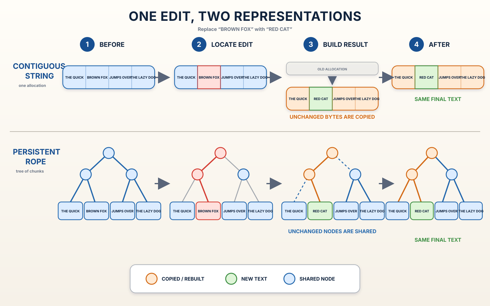

<!--
SPDX-FileCopyrightText: 2026 Adrian PK
SPDX-License-Identifier: GPL-3.0-only

This file is part of Odra. See COPYING for license terms.
-->

# Contiguous Strings and Persistent Ropes

The easiest correctness model for a text edit is one contiguous string. The
entire text occupies one linear byte sequence, so replacing a range produces a
new sequence from three logical pieces:

1. the unchanged prefix;
2. the replacement text;
3. the unchanged suffix.

That model is simple enough to act as a semantic oracle in tests. It is not
Odra's production storage strategy because rebuilding the result ordinarily
copies unchanged bytes as the buffer grows.

Odra stores canonical text in an immutable persistent rope. Text bytes live in
bounded leaf chunks under summarized internal nodes. A localized edit creates
the replacement leaf and the ancestor nodes on its path. Unchanged nodes remain
immutable and can be shared by the old and new roots.

Both representations must produce exactly the same final UTF-8 byte sequence.
Odra's reference tests apply operations to the simple contiguous model and the
production rope, then compare their results. The model answers *what text is
correct*; the rope determines *how to preserve that result efficiently with
explicit ownership*.

The production behavior and limits are specified in
[Single-Buffer Single-Splice Editing](../../../ops/default/spec/stable/single-buffer-single-splice-editing.md).
