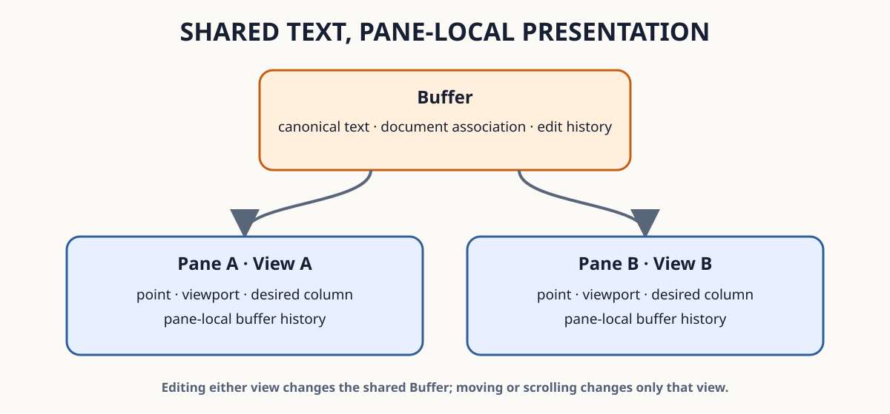

<!--
SPDX-FileCopyrightText: 2026 Adrian PK
SPDX-License-Identifier: GPL-3.0-only

This file is part of Odra. See COPYING for license terms.
-->

# Understand Pane-Local State

This chapter compares two views of shared text, restores pane-local buffer
history, and uses selecting and display-only commands to control where a
buffer appears.

## Before You Begin

If you enter this chapter directly, first complete [Prepare the User Guide
Exercises](../getting-started/prepare-exercises.md).

Complete [Arrange Panes](arrange-panes.md). Open the same kit-supplied
editing-practice file in a wide terminal and create one pane to the right:

```sh
odra ~/odra-guide/work/dirs/notes/editing-practice.txt
```

Press `C-x 3`. Both panes initially show the same buffer.

The diagram summarizes the relationship exercised below. It represents two
views of the same tutorial Buffer; labels and structure carry the meaning
without depending on a particular theme.



## Compare Two Views of One Buffer

In the left pane, move to `Page 2 checkpoint` and page down until the Status
Bar no longer reports `Top`. Press `C-x o` and keep the right pane near the
start of the document.

Move between the panes with `C-x o`. Each pane retains its own cursor,
preferred vertical column, viewport, and horizontal position. Focusing a pane
makes its retained cursor the active point for editing commands.

Insert one character in either pane, then undo it with `C-/`. Canonical text
is shared, so the edit and its reversal are visible in both panes. View
position is pane-local; text and its reversible history belong to the buffer.

## Select a Buffer in Another Pane

Keep the left pane active. Press `C-x 4 b`, enter `pane-notes`, and press Enter
on the `create` candidate.

Odra chooses the other pane, displays the new pathless buffer there, and
focuses it. Type:

```text
Other-pane selection keeps this view active.
```

`C-x 4 b` expresses selecting other-pane intent. It does not require a
particular split orientation, and policy may reuse an eligible existing pane
or create one when geometry permits.

## Display Without Moving Focus

With `pane-notes` active, press `C-x 4 C-o`. Select the editing-practice
buffer. Odra displays it in another pane but leaves focus and input in
`pane-notes`.

Type `!` and observe that it is appended to the notes buffer, not to the
newly displayed practice file. Press `C-/` to undo the marker.

`C-x 4 C-o` is display-only. It is useful when source, output, help, or another
reference should become visible without interrupting the current editing
location.

## Open a File and Focus Its Pane

Press `C-x 4 f`, enter the path below, and press Enter:

```text
~/odra-guide/work/dirs/notes/review.md
```

The kit also supplies this review file.

Odra opens or reuses the file in another pane and focuses the destination.
This has the file-path semantics of `C-x C-f` and the selecting destination
semantics of `C-x 4 b`.

Press `C-g` during any of these candidate or path interactions to preserve the
current layout, displayed buffers, and focus.

## Revisit Pane-Local Buffer History

In the active pane, use `C-x b` to switch from `review.md` to `pane-notes`.
Move its cursor to the middle of the line, then switch back to `review.md` and
move to another line.

Use `C-x b` to select `pane-notes` again. That pane restores the notes cursor
and viewport it retained. A different pane may show the same buffer with a
different cursor and viewport because its buffer history is independent.

When a displayed buffer closes, each affected pane first uses its own live
history for a fallback. Layout-wide buffer recency is used only when that pane
has no suitable local entry.

## Recognize Pane Dedication

Pane dedication is persistent policy state that can reserve a pane from
automatic reuse. `Soft` excludes automatic reuse while allowing an explicit
buffer switch; `Hard` also rejects ordinary explicit replacement. When a pane
is dedicated, its Status Bar exposes the corresponding state.

The direct interaction profile currently has no factory command for changing
dedication. The exercises in this chapter therefore use ordinary panes while
preserving the observable behavior and terminology needed by later
configuration and extension workflows.

## Verify the Result

You have completed this chapter when two panes retain different positions in
the same text, edits remain shared, `C-x 4 b` and `C-x 4 f` focus their
destination, `C-x 4 C-o` preserves focus, and revisiting a buffer restores the
state retained by that pane.

Continue with [Restore Layouts](restore-layouts.md) to preserve and recover a
portable multi-pane arrangement.

For exact view ownership, history fallback, dedication, and automatic display
policy, see the [Pane Layout Reference](../../../reference/pane-layout/index.md).

---

[Previous: Arrange Panes](arrange-panes.md) ·
[User Guide](../index.md) ·
[Next: Restore Layouts](restore-layouts.md)
