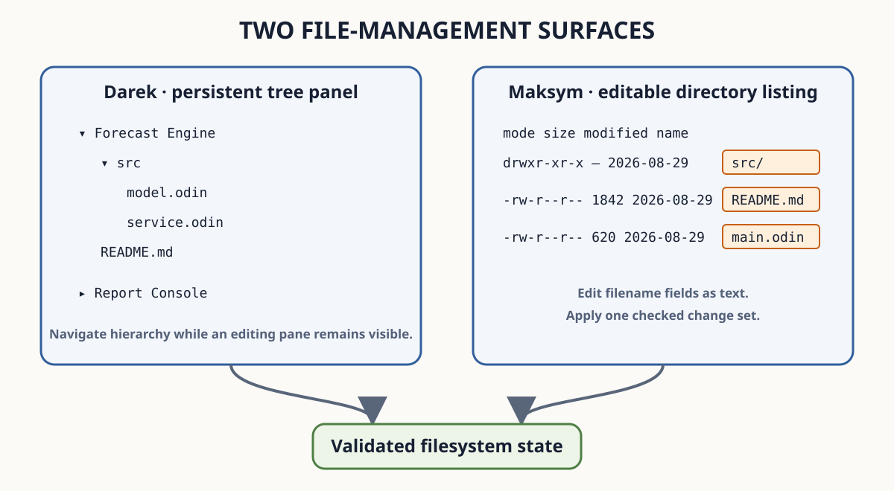

<!--
SPDX-FileCopyrightText: 2026 Adrian PK
SPDX-License-Identifier: GPL-3.0-only

This file is part of Odra. See COPYING for license terms.
-->

# Files, Projects, and Workspaces

This part teaches how Odra opens filesystem roots, recognizes Projects,
composes Workspaces, and manages files through two complementary modules.

Follow these chapters before entering either file-management module:

1. [Choose a Working Context](choose-a-working-context.md) distinguishes a
   Dir, Project, and Workspace through their visible behavior.
2. [Navigate Filesystem Paths](navigate-filesystem-paths.md) uses interactive
   completion to open files and directories.
3. [Manage a Project](manage-a-project.md) teaches promotion, discovery,
   trust, refresh, and removal.
4. [Manage a Workspace](manage-a-workspace.md) teaches durable multi-Project
   composition and activation.
5. [Manage Repository Changes with Ksawery](manage-changes-with-ksawery.md)
   teaches full-canvas Status, path inspection, and complete-path stage and
   unstage.

## Context Workflows

- [Choose a Working Context](choose-a-working-context.md)
- [Open and Navigate a Dir](../../dir-first-opening/index.md)
- [Open and Inspect a Project](../../project-context/index.md)
- [Inspect Local Project Authority](../../project-catalog/index.md)
- [Navigate and Operate on an Active Project](../../project-command-workflows/index.md)

## File-Management Modules

- [Darek](darek/index.md) keeps a persistent tree beside ordinary editing.
- [Maksym](maksym/index.md) presents an editable directory listing and validates
  changes before applying them to the filesystem.

## Version Management

- [Ksawery](manage-changes-with-ksawery.md) presents repository Status as a
  dedicated full-canvas session while retaining the editor canvas beneath it.

The maintained tutorial Workspace reproduces both surfaces over the same
Project roots. The diagram distinguishes their spatial and editing roles;
labels and structure remain meaningful without its colors.

---

[Previous: Search Projects and Symbols](../search-and-navigation/search-projects-and-symbols.md) ·
[User Guide](../index.md) ·
[Next: Choose a Working Context](choose-a-working-context.md)
