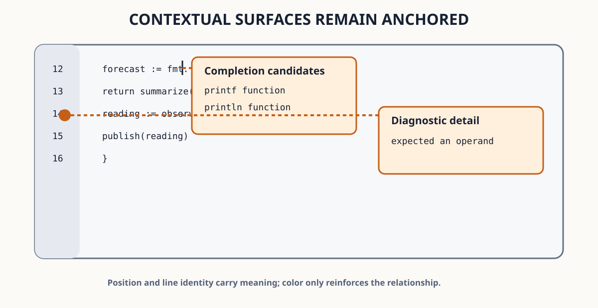

<!--
SPDX-FileCopyrightText: 2026 Adrian PK
SPDX-License-Identifier: GPL-3.0-only

This file is part of Odra. See COPYING for license terms.
-->

# Use Language Completion

This chapter requests semantic candidates manually and through a trigger,
filters and inspects the list while the source retains focus, accepts or
cancels an exact generation, reverses the complete accepted edit, and changes
the completion limits and trigger policy.

## Before You Begin

If you enter this chapter directly, first complete [Prepare the User Guide
Exercises](../getting-started/prepare-exercises.md).

Complete
[Use the Basic Language Pack](use-the-basic-language-pack.md).
Open `Forecast Engine/main.odin` through the exact trusted Project and run
`M-x describe-language-service`. Continue when the session is active, the
document is synchronized at its current revision, and completion support is
negotiated.

The exercise kit supplies the Project and source file. This chapter makes only
disposable buffer edits until the configuration section, which extends the
reader-created `init.rkt` from the linked configuration chapters.

Completion remains unavailable for an ordinary Dir, an untrusted Project, an
unsupported document, or a service without the negotiated capability. Those
states never disable ordinary text editing.

## Request Candidates Manually

Inside `main`, create a disposable line and type `fmt` without the dot. Press
`C-M-i` to run `complete-at-point`.

A compact theme-aware candidate popup appears beside point while the source
text view retains input focus. Candidate icons distinguish callables, values,
types, modules, fields, and other normalized semantic kinds. A portable icon
profile uses the corresponding text labels instead.

Use `C-n` and `C-p`, or `Down` and `Up`, to move through candidates. Press
`M-<` or `M->` to select the first or last visible candidate. Press `M-?` to
show or hide available detail for the selected item.

Run `M-x describe-completion-state` while the popup is active. Status feedback
reports the controller state, provider count, visible count, selected identity,
request generation, and latest bounded failure without ending the interaction.

Press `C-g`. The popup closes, no candidate edit is applied, and the typed
`fmt` remains ordinary source text. Remove the disposable line.

The diagram uses the same qualified-name and diagnostic scenarios as the
tutorial Workspace. It shows why completion stays beside point while a marker
detail stays beside its Gutter line; position and labels carry the meaning
independently of theme color.



## Request Through a Trigger

Create another disposable line and type `fmt.`. The server-advertised `.`
trigger requests candidates automatically under the factory policy.

Type `pr` while the list is visible. Those characters enter the source buffer
and locally narrow a compatible complete candidate batch. An incomplete
provider batch instead requests a newer generation. Selection remains stable
when the same candidate identity survives the replacement.

Choose `printf` or another matching callable and press `RET` or `TAB`. The
selected candidate replaces the admitted prefix rather than deleting its
qualifying `fmt.` receiver.

## Reverse the Complete Acceptance

An accepted candidate may contain one primary edit and bounded non-overlapping
additional edits, such as an import. Odra revalidates the complete controller,
provider, service, document, revision, view, batch, and candidate authority
before publishing all admitted edits as one transaction.

Press `C-/` once. The primary and every additional edit disappear as one
history unit. Run `M-x redo`; the complete candidate effect returns together.
Undo the disposable completion again before continuing.

The maintained focused acceptance fixture supplies both a primary and an
additional edit, so this atomic boundary is verified even when the current OLS
candidate needs only a primary replacement.

## Observe Dismissal and Stale Protection

Request completion, then move point outside the compatible source context or
switch to another view. Odra dismisses the session and removes its transient
input map.

Request again, type enough text to replace the active request, and try to use
an older visible generation. A late provider response cannot reopen or
authorize that retired session. Read-only documents, stale ranges, overlapping
additional edits, and transaction failure publish no partial text.

Open `~/odra-guide/work/dirs/notes/editing-practice.txt` and press `C-M-i`.
`Completion unavailable for current document` reports the expected absence of
an eligible synchronized provider; the text file remains editable.

## Configure the Admitted Policy

Open `~/odra-guide/config/odra/init.rkt`. If it already contains other
configuration exports, preserve them and add the completion import, export,
and definition instead of replacing the module:

```racket
#lang racket/base

(require odra/completion)

(provide odra-completion-configuration)

(define odra-completion-configuration
  (completion-configuration
   #:enabled? #t
   #:explicit? #t
   #:identifier? #t
   #:trigger-character? #t
   #:minimum-prefix 3
   #:case-sensitive-prefix? #t
   #:case-insensitive-prefix? #t
   #:subsequence? #f))
```

Save the file and run `M-x reload-personal-commands`. The complete valid value
replaces the active policy atomically and cancels any old completion session.
Invalid configuration preserves the last valid generation.

With identifier invocation enabled, typing the third compatible identifier
character may request completion without `C-M-i`. Set `#:identifier? #f` to
retain only explicit requests and server-advertised triggers. Set
`#:enabled? #f` to disable both automatic and explicit factory completion.

Restore the desired tutorial policy before leaving the chapter.

## Recover from Completion Problems

- Run `M-x describe-completion-state`, then
  `M-x describe-language-service`, to separate interaction state from provider
  health.
- If completion is unavailable, verify policy, selected language, exact trusted
  Project membership, synchronized revision, active service, and negotiated
  capability in that order.
- If a request becomes stale, continue editing and request a new current
  generation rather than retrying an old candidate.
- If geometry cannot present the popup, enlarge the terminal or simplify the
  pane layout; source text and completion semantics remain unchanged.
- `C-g` always cancels the active completion interaction before acting as a
  broader editor cancellation.

## Verify the Result

You have completed this chapter when manual and trigger-character requests
show candidates, typing narrows the list without losing the receiver,
navigation and detail remain contextual, cancellation applies nothing,
acceptance is one reversible transaction, stale or unavailable sessions leave
editing usable, and a checked configuration reload changes invocation policy.

For focused configuration and diagnosis, see
[Configure and Diagnose Language Completion](../../../how-to/configure-language-completion/index.md).
For exact commands, bounds, and lifecycle, see the
[Language Completion Reference](../../../reference/language-completion/index.md).
For the ownership rationale, see
[Why Language Completion Separates Provider, Session, and Acceptance](../../../explanation/language-completion/index.md).

---

[Previous: Use the Basic Language Pack](use-the-basic-language-pack.md) ·
[User Guide](../index.md) ·
[Next: Understand Provider Fallback](provider-fallback.md)
